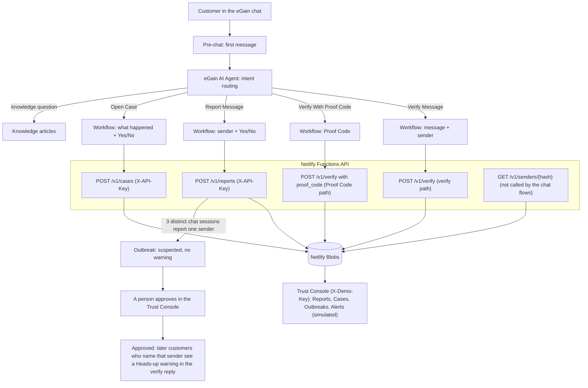

# Really Us?
**Scammers pretend to be your company. Really Us lets customers check before they act, and warns the next customer once a person approves.**

People reported losing $3.5 billion to impostor scams in the US in 2025, nearly 1 in 3 fraud reports ([U.S. FTC, June 2026](https://www.ftc.gov/news-events/news/press-releases/2026/06/ftc-data-show-people-reported-losing-3-point-5-billion-imposter-scams-2025)).

- **Demo video:** https://youtu.be/PRNmeJox_NE
- **Demo Link (eGain agent, opens without a code):** [open the chat](https://ai.egain.cloud/d3y6/system/web/apps/aiagent/demo.html?agentId=714122e0-9c7e-4143-8554-12afacbf3728&backgroundUrl=https://cdn.aiagent.egain.cloud/TMPRODB52840291/screenshots/7ac7046c-bc4b-4b04-b0af-a67ce25d3f2c.png)
- **Trust Console:** https://really-us-verifier.netlify.app/trust.html (demo key on email request, see "Testing")

*Everyone tries to spot the fake. We prove the real.*

**TL;DR**
- An eGain AI Agent that answers "Is this message really from us?" for a utility's customers.
- It helps customers check a suspicious message before they call, click or pay, and gives support teams an earlier warning of scam waves.
- The AI suggests; the workflow decides; a human approves.
- All companies, accounts, numbers and notices are fictional.

A customer gets "Your power will be cut at 9:30 tonight." Really Us?, built on eGain AI Agent,
lets them ask the only party that knows: the company named in the message.

> All companies, accounts, numbers and notices are fictional demo data.

## For judges: 60-second tour
| Want to | Go to |
|---|---|
| Try the agent | [Demo Link](https://ai.egain.cloud/d3y6/system/web/apps/aiagent/demo.html?agentId=714122e0-9c7e-4143-8554-12afacbf3728&backgroundUrl=https://cdn.aiagent.egain.cloud/TMPRODB52840291/screenshots/7ac7046c-bc4b-4b04-b0af-a67ce25d3f2c.png) (opens without a code) |
| See the live demo site | [https://really-us-verifier.netlify.app](https://really-us-verifier.netlify.app) |
| See the 1-minute video | https://youtu.be/PRNmeJox_NE |
| Check every rule against evidence | [docs/JUDGES.md](docs/JUDGES.md) |
| See test results | [docs/TEST_PLAN.md](docs/TEST_PLAN.md) |
| Understand the design | [docs/ARCHITECTURE.md](docs/ARCHITECTURE.md) |
| Read platform feedback for eGain | [docs/FRICTION_LOG.md](docs/FRICTION_LOG.md) |

## Judging map
| Criterion (points) | Evidence in this repo / live | How to try it |
|---|---|---|
| Customer & business value (25) | FTC figure above; one clear verdict, 3 reasons, one next step; earlier warning of scam waves for support teams (`docs/PRD.md`) | Paste a scam text as the first chat message |
| Functionality & reliability (25) | 296 of 296 API tests in 15 files and the harness pass; owner chat runs in `docs/TEST_PLAN.md` | `make verify`, or the chats in "How to test" |
| Action & good judgment (25) | Writes need `confirmed=true` and an `idempotency_key`; three verdicts only; outbreak warning needs a person's approval (`api/src/handlers.ts`, `api/src/outbreak.ts`) | Report a sender, answer Yes or No; approve an outbreak in the Trust Console |
| Effective use of eGain (20) | Knowledge, Pre-chat, Process workflows on intents, Escalation, API calls with an External Credential (`egain/`, `docs/JUDGES.md`) | Demo Link; "I want to talk to a human agent" |
| Creativity & customer experience (15) | Proof Code on a real notice; "Heads-up" for the next customer; second company on the same API | `I have a Proof Code`, then `NP-4821` |
| Demo video & storytelling (15) | Video: https://youtu.be/PRNmeJox_NE; story in `docs/DESIGN.md` | Watch the video |

## Feature tour
| Feature | What it does | First message to try |
|---|---|---|
| Verify | Deterministic verdict (`MATCHES_SCAM_SIGNS`, `NO_MATCHING_NOTICE`, `GENUINE_NOTICE_FOUND`), 3 reasons, one next step | Paste the suspicious message, then give the sender |
| Proof Code | A code printed on a real notice confirms that one notice | "I have a Proof Code", then `NP-4821` |
| Report | Reports a sender after a Yes; returns a reference `RPT-...` | "Report a suspicious message" |
| Open Case | Opens a fraud case after a Yes; returns a case number; no recovery promise | "I already paid" |
| Outbreak + human approval | 3 different chat sessions report one sender: suspected, no warning. After a person approves in the Trust Console, the next customer who names that sender sees "Heads-up" | Report the same sender from 3 new chats, approve, then verify a message from it |
| Knowledge drafts | The console creates a draft from an outbreak; a person approves it. Nothing is uploaded to eGain knowledge | Trust Console, on an approved outbreak |
| Knowledge answers | Grounded answers with sources | "How does disconnection for non-payment work?", "What is a Proof Code?" |
| Examplia Bank | Second fictional company; verify flow on the same API | "Examplia Bank security: confirm your password and username to unlock your account.", then sender "unknown" |
| Escalation | Two choices: Call or Email the fraud desk (fictional contacts) | "I want to talk to a human agent" |
| Pre-chat greeting | Says it is an AI assistant for a fictional company and asks the customer not to share passwords, OTPs or card numbers; then asks for the message | Open the Demo Link |
| Audit log | Records ids and outcomes (no message text, no sender); shown as the console "Live feed" | Trust Console |
| Trust Console tiles | Reports, Cases, Outbreaks, Alerts (simulated) | Trust Console (demo key) |

Nothing is sent or published automatically.

## What it will not do
- Ask for passwords, one-time codes or card numbers. The Pre-chat and knowledge articles tell customers not to share them.
- Call a message "safe". The word is not in any verdict or knowledge text.
- Confirm more than one notice with a Proof Code. It confirms the code, not the notice text.
- Show an outbreak warning without a person's approval.
- Send real SMS or email. Alerts are simulated; nobody is contacted.
- Guess when it cannot help. Off-topic questions get a standard reply that points to a person.

## Beyond the tutorial
| Built | Where |
|---|---|
| Own API on Netlify Functions + Netlify Blobs | `api/`, `netlify/` |
| Deterministic verdict rules, never model text | `api/src/verdict.ts` |
| Outbreak logic over distinct chat sessions; official senders never count | `api/src/outbreak.ts`, `api/src/handlers.ts`, `api/src/sender.ts` |
| Trust Console with human approval | `console/trust.html`, `api/src/console.ts` |
| Proof Codes (demo-only) | `api/src/proofcode.ts`, `api/src/fixtures.ts` |
| Second company config (Examplia Bank, in eGain); a third config (Examplia Mobile) is API-only | `api/src/companies/` |
| Tests and harness: 296 of 296 tests in 15 files pass; `scripts/harness_check.py` PASSED (2026-11-12) | `api/test/`, `scripts/` |

## Architecture

Verdicts come from deterministic rules in the API, never from model text. Writes need `confirmed=true` and an `idempotency_key`.

## Repo map
`docs/` product, design, architecture, tests, decisions, friction log
`egain/` node-by-node eGain build specs (the "Trust Check" template)
`knowledge/` fictional articles for the agent
`api/` demo API and tests | `console/` Trust Console and demo page
`test-results/` recorded evidence | `CLAUDE.md` rules for coding agents

## Status (honest)
| Part | State |
|---|---|
| Demo API (verify, Proof Code, reports, cases, outbreaks, approval) | Built; unit tests; running in production |
| Netlify Functions HTTP layer | Built and running at https://really-us-verifier.netlify.app |
| Storage (Netlify Blobs) | Running in production; reports, cases and outbreaks persisted (owner-verified 2026-11-10) |
| Trust Console (`console/trust.html`) and demo home page (`console/index.html`) | Running in production; outbreak approval and draft approval done in it |
| eGain agent and workflows | Published and run in chat (owner-verified 2026-11-10). Facts are recorded in `egain/` and `docs/TEST_PLAN.md`; they cannot be re-checked from this repo |
| Second fictional company (Examplia Bank) | Works in eGain through the Process "Verify Bank Message" and the intent "Check a message from my bank" (owner-verified 2026-11-10). Verify flow only; report, case and Proof Code flows are Northline only. Same agent and same Pre-chat greeting, which is written for Northline |
| Full test run (T1-T23) on eGain | Not re-run end to end. Core flows and T24 (6/6) were checked live on the published agent on 12-13 Nov; see "Live validation on the published agent" below |
| Video, final description, submission, license | Done: 1-minute video https://youtu.be/PRNmeJox_NE, Devpost and eGain forms submitted 12-13 Nov 2026, MIT license |

## Live URLs
Note: After creation the eGain settings box shows an empty URL field, but the Demo Link itself works, so the link is kept in this repository.

- Demo Link (eGain agent): https://ai.egain.cloud/d3y6/system/web/apps/aiagent/demo.html?agentId=714122e0-9c7e-4143-8554-12afacbf3728&backgroundUrl=https://cdn.aiagent.egain.cloud/TMPRODB52840291/screenshots/7ac7046c-bc4b-4b04-b0af-a67ce25d3f2c.png
- Demo site and API: https://really-us-verifier.netlify.app (Trust Console at `/trust.html`, needs the demo key)

## Live validation on the published agent (12–13 Nov 2026)

Run by hand in the published Demo Link (and Verify + Escalation also in eGain Test AI Agent). API unit tests are separate (see Measured facts).

| Check | Result |
| --- | --- |
| Verify: power-cut scam text, sender unknown | Matches scam signs, 3 reasons, 1 next step |
| Proof Code NP-4821 | Genuine notice found (one notice only) |
| Report a suspicious message | RPT receipt |
| Open Case ("I already paid") | CASE number + safe steps |
| Escalation ("I want to talk to a human agent") | Call / Email the fraud desk |
| Examplia Bank verify | Matches scam signs |
| Outbreak chain | 3 chat sessions reported, a person approved in the Trust Console, next check of +1 555 0177 shows the heads-up |
| T24, new rules from PR #13 (13 Nov) | 6/6 pass: Zelle/Cash App, "in 20 minutes" + call a number, verification code, IP link + log in to restore, gift voucher -> Matches scam signs; genuine notice with Proof Code -> no known scam patterns, Genuine notice found |

Not run on the published agent: API-down behaviour. The full T1–T23 matrix in docs/TEST_PLAN.md was not re-run end to end after the intents were rewired on 12 Nov; the rows above are what was checked live.

## Known limits

- When the rules look for a phone number inside a message, official numbers are matched on their last 7 digits (api/src/verdict.ts), so a different number ending in the same 7 digits would not raise the "unofficial phone" signal. A production version should compare the full normalised number.
- Outbreaks count distinct chat sessions, not verified people; one person opening three chats could trigger a suspected outbreak. This is why a person must approve every outbreak before any warning is shown.
- Paste the real message as the FIRST message in the chat. If a customer first types something else, that sentence is checked as the message.
- Proof Code verification confirms the code (one notice). It does not compare the notice text.
- Questions about restoring power after a disconnection get the out-of-scope reply with a hand-off to a person; questions about how disconnection works are answered.
- The scam rules are deliberately narrow and deterministic. A message with none of the listed signs, such as "Your bill is overdue. Reply YES to pay.", is not flagged. The reply then says "no matching notice" and "do not act yet".
- The rules are narrow. On our own 20-sample set (written by us after review, not an independent evaluation; `api/test/sample-set.test.ts`) the result before the fix was 10 of 10 genuine notices flagged and 10 of 10 scams missed; after the fix it is 0 genuine flagged and 0 scams missed. The set was used to write the fix, so it does not measure how the rules do on new messages.
- Proof Codes are demo-only: static, reusable and guessable (10,000 possible codes per company). A production design needs per-notice one-time codes and rate limiting.
- `POST /v1/verify` has no rate limit.
- `GET /v1/senders/{hash}` needs no key, and the sender hash is an unsalted SHA-256, so anyone can hash a sender and look up its report count.
- The customer reference used for outbreak counting is the chat session id, so one person opening three chats could trigger an outbreak.
- Alerts are simulated. Nobody is contacted. Approving a knowledge draft records the human approval only; nothing is uploaded to eGain knowledge.
- The demo failure paths (`TESTFAIL`, `TESTFAILWRITE`) trigger by `company_id` only, so they are verified by unit tests and direct API calls, not from the chat. The Report Message success condition (`status === 200 && body.success === true`) is published in v2 and was tested with a normal report reference.
- The keys `rep-{{sessionId}}` and `case-{{sessionId}}` repeat inside one chat. A second report or case in the same chat with different details is rejected by the API (409), and the customer sees the error text.
- The Report body sends a `message` field. The API ignores it and does not store it.
- Concurrent duplicate requests are not fully atomic: two requests with the same new idempotency key at the same instant can both run (unchanged). The eGain Test panel hides some mapped values.
- The full T1-T23 run on eGain is not done yet.
- No per-company data separation: all companies share one Blobs store, one Trust Console and one API key.
- No self-serve onboarding. A new company is added by hand; see [docs/ONBOARDING.md](docs/ONBOARDING.md).
- Detecting one scam campaign across different sender numbers is NOT built (future work). An outbreak is keyed by company and sender hash only.
- The raw sender is never stored. Reports keep only an unsalted SHA-256 hash of the sender and a masked form (last 4 digits).
- Proof Codes being demo-only, alerts being simulated and the Trust Console key being available by email are covered above and under "Testing".

## Endpoints
`POST /v1/verify`, `GET /v1/senders/{hash}`, `POST /v1/reports` and `POST /v1/cases` (`X-API-Key`), and the Trust Console endpoints (`X-Demo-Key`): `GET /v1/console/state`, `POST /v1/outbreaks/{id}/approve`, `POST /v1/outbreaks/{id}/draft`, `POST /v1/drafts/{id}/approve`, `POST /v1/demo/reset`. Details: [docs/TECHNOLOGY.md](docs/TECHNOLOGY.md).

## How to test
Open the Demo Link: https://ai.egain.cloud/d3y6/system/web/apps/aiagent/demo.html?agentId=714122e0-9c7e-4143-8554-12afacbf3728&backgroundUrl=https://cdn.aiagent.egain.cloud/TMPRODB52840291/screenshots/7ac7046c-bc4b-4b04-b0af-a67ce25d3f2c.png

These chat paths are the owner's own test steps. They cannot be re-checked from this repo.
1. Paste the suspicious message as the FIRST chat message.
2. Each workflow runs once per chat, so start a new chat after a result.
3. To report: start a new chat, type "Report a suspicious message" as the first message, then give the sender, then answer Yes.
4. Other first messages that work: "I already paid" (Open Case); "I have a Proof Code", then `NP-4821`; "I want to talk to a human agent" (Escalation); a knowledge question such as "How does disconnection for non-payment work?", "How can I pay my bill safely?", "Does Northline ask for passwords or one-time codes?" or "Will Northline ever call me from a mobile number?"
5. Bank example: "Examplia Bank security: confirm your password and username to unlock your account.", then sender "unknown".

## Measured facts
Measured on 2026-11-12 by running them on this branch: `npm test` in `api/` passes 296 of 296 tests in 15 files (TypeScript check included), and `python scripts/harness_check.py` reports PASSED. The Trust Console shows four tiles: Reports, Cases, Outbreaks, Alerts (simulated). No resolution rate or customer outcome is measured.

## Testing
The Trust Console is protected by a demo key and is shown in the demo video. Judges who want to try it can email contact@srdevelopers.live to request a temporary key. It controls fictional demo data only.

## Run
`make verify` runs the harness checks and tests. Keys are set as environment variables (`API_KEY`, `DEMO_KEY`, `DEMO_DATA_ONLY`); see `.env.example` for the names. Never commit values.

Deploy note: the functions need `@netlify/blobs` resolvable from the repo root. Run `npm install` in the repo root (not only in `api/`) before a CLI deploy. A Netlify build runs `npm ci --omit=dev` itself.

## License
MIT, see [LICENSE](LICENSE). Copyright (c) 2026 Venkateswara Rao Pathuri. The demo data is fictional, and so are the names Northline Power, Examplia Bank and Examplia Mobile.

## AI use and disclosure
Built with Claude Code and other AI tools, as the rules permit. The author reviewed and can explain the solution.
Pre-existing templates, code or third-party assets are listed in `docs/DECISIONS.md`.
Not affiliated with or endorsed by eGain or any company named in research.
